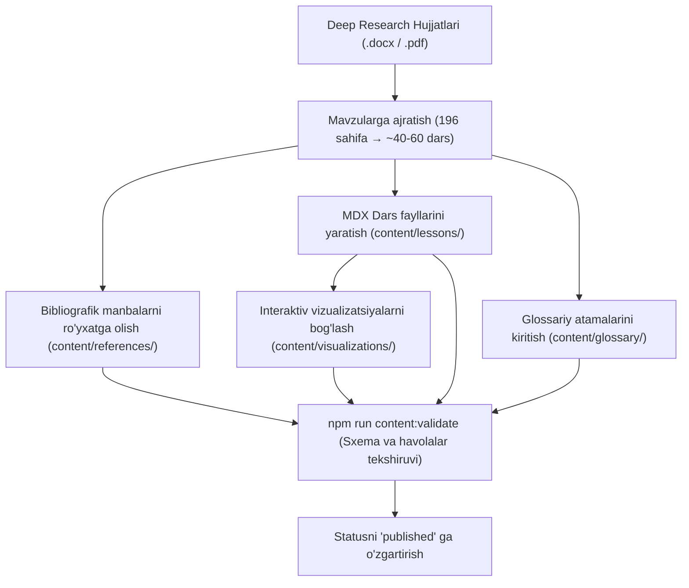

# AI Atlas — 2-Bosqich Kontent Integratsiyasi Qo'llanmasi (CONTENT_GUIDE)

Ushbu qo'llanma Phase 2 da Google Gemini Deep Research orqali olingan ~196 sahifalik ilmiy-ta'limiy materiallarni **AI Atlas** platformasiga qanday kiritish va qayta ishlash kerakligini ko'rsatib beradi.

---

## 1. Integratsiya Jarayoni Bosqichlari



---

## 2. Dars Fayli Standarti (MDX)

Har bir dars `src/content/lessons/<slug>.mdx` manzilida joylashadi.

### A. Majburiy Frontmatter Namunasi

```yaml
---
id: transformer-architecture
title: Transformer Arxitekturasi va Self-Attention
slug: transformer-architecture
description: Transformer modellarining ichki tuzilishi, multi-head attention va positional encoding mexanizmlari.
category: transformers
difficulty: intermediate
order: 1
tags: ["transformers", "attention", "nlp", "llm"]
prerequisites: ["neural-networks-basics"]
related: ["bert-and-gpt", "positional-encoding"]
visualizations: ["transformer-encoder-flow"]
sources: ["vaswani-2017", "devlin-2018"]
origin:
  - document: "ai research.docx"
    section: "3.2 Transformer Block Structure"
    pages: "45-52"
    note: "Gemini Deep Research 2-qismidan ajratib olingan"
status: published
locale: uz
---
```

### B. Frontmatter Maydonlari Izohi

| Maydon | Turi | Tavsif |
| :--- | :--- | :--- |
| `id` | String | Noyob identifikator (kebab-case) |
| `title` | String | Dars sarlavhasi (O'zbek tilida, texnik atamalar saqlangan holda) |
| `slug` | String | URL manzili (`/learn/[slug]`) |
| `description` | String | Qisqa annotatsiya (qidiruv va dars kartochkalari uchun) |
| `category` | String | `categories.json` dagi kategoriya identifikatori |
| `difficulty` | Enum | `beginner` \| `intermediate` \| `advanced` |
| `order` | Integer | Kategoriya ichidagi o'qish tartibi (1, 2, 3...) |
| `tags` | Array | Qidiruv va bog'liqliklar uchun kalit so'zlar |
| `prerequisites` | Array | Ushbu darsdan oldin o'rganilishi shart bo'lgan dars ID lari (**Yo'l xaritasi grafini shu maydon hosil qiladi**) |
| `related` | Array | O'zaro bog'liq boshqa darslar ID lari |
| `visualizations` | Array | Darsga tegishli vizualizatsiya identifikatorlari |
| `sources` | Array | `references/` dagi ilmiy maqola ID lari |
| `origin` | Array | **Kelib chiqish manbasi (Deep Research hujjati, bo'limi, sahifasi)** |
| `status` | Enum | `draft` (qoralama) \| `review` \| `published` (talabalarga ko'rinadigan) |

---

## 3. Maxsus MDX Komponentlaridan Foydalanish

Dars matnida standart Markdown bilan bir qatorda quyidagi maxsus komponentlar ishlatiladi:

### 1. Matematik Formulalar (KaTeX)

Inline formula uchun: `$E = mc^2$` yoki `$Q, K, V \in \mathbb{R}^{n \times d}$`.

Blokli formulalar uchun:
```markdown
$$
\text{Attention}(Q, K, V) = \text{softmax}\left(\frac{QK^T}{\sqrt{d_k}}\right)V
$$
```

Yoki tushuntirishli maxsus blok:
```jsx
<MathBlock
  math="\text{CrossEntropy}(y, \hat{y}) = -\sum_{i} y_i \log(\hat{y}_i)"
  explanation="Klassifikatsiya masalalarida haqiqiy va bashorat qilingan taqsimotlar orasidagi farqni o'lchovchi yo'qotish funksiyasi."
/>
```

### 2. Dasturiy Kod Bloklari (Shiki)

```python
import torch
import torch.nn as nn

class ScaledDotProductAttention(nn.Module):
    def __init__(self, d_k: int):
        super().__init__()
        self.scale = 1.0 / (d_k ** 0.5)

    def forward(self, q, k, v, mask=None):
        scores = torch.matmul(q, k.transpose(-2, -1)) * self.scale
        if mask is not None:
            scores = scores.masked_fill(mask == 0, -1e9)
        weights = torch.softmax(scores, dim=-1)
        return torch.matmul(weights, v), weights
```

### 3. Diqqat va Maslahat Bloklari (Callout)

```jsx
<Callout type="tip" title="Muhim tavsiya">
Multi-head attention hisoblashda $d_k$ ga bo'lish gradientlarning so'nib ketishini (vanishing gradient) oldini oladi.
</Callout>

<Callout type="warning" title="E'tibor bering">
Positional encoding qo'shilmasa, Transformer model so'zlarning ketma-ketlikdagi tartibini ajrata olmaydi.
</Callout>
```

Turlari: `note`, `tip`, `important`, `warning`, `definition`, `example`.

### 4. Ilmiy Manbalar Iqtibosi (Cite)

```markdown
Ushbu yondashuv birinchi marta Vaswani et al. <Cite id="vaswani-2017" /> tomonidan taklif qilingan.
```

### 5. Texnik Atamalar Glossariysi (Term)

```markdown
Ushbu bosqichda <Term id="self-attention">Self-Attention</Term> mexanizmi faollashadi.
```

### 6. Interaktiv Vizualizatsiyani Dars Ichiga Joylash

```jsx
<Visualization id="rag-pipeline-flow" />
```

---

## 4. Manbalarni Ro'yxatga Olish (`src/content/references/`)

Har bir ilmiy maqola, kitob yoki tadqiqot `src/content/references/*.json` fayliga kiritiladi:

```json
[
  {
    "id": "vaswani-2017",
    "type": "paper",
    "title": "Attention Is All You Need",
    "authors": ["Ashish Vaswani", "Noam Shazeer", "Niki Parmar", "Jakob Uszkoreit"],
    "year": 2017,
    "venue": "NeurIPS",
    "url": "https://arxiv.org/abs/1706.03762",
    "sourceDocument": "ai research.docx"
  }
]
```

---

## 5. Yangi Interaktiv Vizualizatsiya Yaratish (`src/content/visualizations/`)

Har qanday vizualizatsiya parametrlarini JSON orqali e'lon qilish mumkin:

### Misol: Matematik Funksiya Grafigi
```json
{
  "id": "sigmoid-activation",
  "type": "function-plot",
  "title": "Sigmoid faollashtirish funksiyasi",
  "description": "Kiruvchi qiymatlarni (0, 1) oraliqqa siquvchi silliq nolinchi bo'lmagan egri chiziq.",
  "status": "published",
  "synthetic": false,
  "config": {
    "expressions": [
      {
        "id": "sigmoid",
        "label": "σ(x)",
        "expr": "1 / (1 + exp(-x))",
        "color": "cyan"
      }
    ],
    "parameters": [],
    "xDomain": [-6, 6],
    "yDomain": [-0.1, 1.1],
    "xLabel": "Kirish (z)",
    "yLabel": "Chiqish σ(z)"
  }
}
```

---

## 6. Sifat Nazorati va Validatsiya

Har safar yangi darslar qo'shilgach, terminalda quyidagi buyruq ishga tushiriladi:

```bash
npm run content:validate
```

U quyidagilarni avtomatik tekshiradi:
- Barcha frontmatter maydonlari to'g'riligi.
- Hech qanday dars ID si yoki slugi takrorlanmaganligi.
- Barcha prerequisite havolalari haqiqatan mavjudligi va **hech qanday berk sikl yo'qligi**.
- Matn ichidagi iqtiboslar (`<Cite id="...">`) va havolalar buzilmaganligi.
- Vizualizatsiya konfiguratsiyalari to'g'ri ekanligi.

Tekshiruv muvaffaqiyatli yakunlangach, loyiha production rejimida ishga tushishga tayyor bo'ladi:
```bash
npm run build
```
